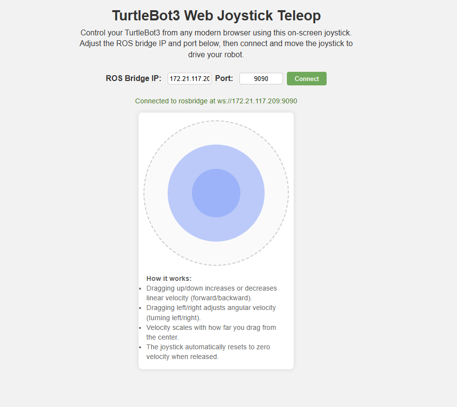

# turtlebot_teleop_joystick (ROS 2 Jazzy)

A lightweight, browser-based joystick teleoperation interface for **TurtleBot3** (both physical robots and Gazebo Harmonic simulations) on **ROS 2 Jazzy Jalisco**.

This project provides an on-screen virtual joystick that publishes velocity commands (`/cmd_vel`) over WebSockets using [`rosbridge_suite`](https://github.com/RobotWebTools/rosbridge_suite).



## Features (ROS 2 Jazzy Update)

- **ROS 2 Jazzy `TwistStamped` & `Twist` Support:** Defaults to `geometry_msgs/msg/TwistStamped` (used by ROS 2 Jazzy `diff_drive_controller` and Gazebo Harmonic) with a dropdown to switch to unstamped `geometry_msgs/msg/Twist`.
- **Namespace & Custom Topic Support:** Optional **Namespace** (e.g., `tb3_0` $\rightarrow$ `/tb3_0/cmd_vel`) and **Topic** fields for multi-robot setups or custom topic remappings.
- **Robot Model & Custom Velocity Presets:** Built-in presets for TurtleBot3 **Burger** (`0.22 m/s`, `2.84 rad/s`), **Waffle / Waffle Pi** (`0.26 m/s`, `1.82 rad/s`), or custom velocity limits.
- **20 Hz Continuous Publishing & Watchdog Safety:** Continuously publishes while the joystick is held so the robot's `cmd_vel` watchdog timer does not time out, and immediately sends a zero-velocity stop command on release, disconnect, or tab blur.
- **`ws://` and `wss://` Support:** Supports both plain local WebSockets and TLS-encrypted WebSockets.

---

## Quick Start

### 1. Install `rosbridge_suite` for ROS 2 Jazzy

```bash
sudo apt-get update
sudo apt-get install ros-jazzy-rosbridge-suite
```

### 2. Launch Your Robot or Simulation

Source your ROS 2 Jazzy environment and launch your TurtleBot3:

```bash
source /opt/ros/jazzy/setup.bash
export TURTLEBOT3_MODEL=burger

# Real robot bringup:
ros2 launch turtlebot3_bringup robot.launch.py

# Or Gazebo simulation:
ros2 launch turtlebot3_gazebo turtlebot3_world.launch.py
```

### 3. Start `rosbridge_server` (Secure Local Setup)

For same-machine testing (bound only to `127.0.0.1` and restricted to `/cmd_vel`):

```bash
source /opt/ros/jazzy/setup.bash
ros2 run rosbridge_server rosbridge_websocket --ros-args \
  -p address:=127.0.0.1 \
  -p port:=9090 \
  -p "topics_pub_glob:=['/cmd_vel']" \
  -p "topics_sub_glob:=[]" \
  -p "services_glob:=[]" \
  -p "actions_glob:=[]"
```

*(See the full [Securing `rosbridge` & Local Network Binding Guide](#securing-rosbridge--local-network-binding-guide) below for LAN/Wi-Fi robot control.)*

### 4. Open `joystick_teleop.html`

Open `joystick_teleop.html` directly in your browser (or serve it with `python3 -m http.server 8000`):

1. Set **IP / Host** to `127.0.0.1` (or your robot's local LAN IP, e.g., `192.168.1.50`) and **Port** to `9090`.
2. Choose `TwistStamped` (default for ROS 2 Jazzy) or `Twist` to match your robot's `/cmd_vel` subscriber (`ros2 topic info /cmd_vel`).
3. Click **Connect** and drag the joystick to drive.

---

## Securing `rosbridge` & Local Network Binding Guide

By default, running `ros2 run rosbridge_server rosbridge_websocket` binds to **all network interfaces (`0.0.0.0:9090`)** without authentication and exposes **every** topic, service, action, and parameter in your ROS 2 graph.

When adding `rosbridge` to a ROS 2 Jazzy project, apply the following layers to bind it strictly to your local network and lock down what clients can access.

### Step 1: Bind `rosbridge` to Loopback or a Specific LAN IP

Use the `address` parameter to control which network interface `rosbridge_websocket` listens on:

- **Same Machine Only (`127.0.0.1`):** Rejects all connections from outside your computer.
  ```bash
  ros2 launch rosbridge_server rosbridge_websocket_launch.xml \
    address:=127.0.0.1 \
    port:=9090
  ```

- **Local Wi-Fi / LAN Interface Only (e.g., `192.168.1.50`):** Check your robot's LAN IP with `ip -4 addr` and bind specifically to that interface IP so `rosbridge` does not listen on other interfaces (such as cellular/WAN modems or public adapters):
  ```bash
  ros2 launch rosbridge_server rosbridge_websocket_launch.xml \
    address:=192.168.1.50 \
    port:=9090
  ```

### Step 2: Restrict Topics, Services, Actions, and Parameters (Least Privilege)

Even on a local network, a teleop web client only needs permission to **publish** to `/cmd_vel` (or `/<namespace>/cmd_vel`). It should not be allowed to subscribe to camera/LiDAR topics, call ROS services, trigger actions, or read/write node parameters.

Pass `rosbridge_server`'s glob filter parameters to block everything except publishing to `/cmd_vel`:

```bash
ros2 run rosbridge_server rosbridge_websocket --ros-args \
  -p address:=192.168.1.50 \
  -p port:=9090 \
  -p "topics_pub_glob:=['/cmd_vel', '/*/cmd_vel']" \
  -p "topics_sub_glob:=[]" \
  -p "services_glob:=[]" \
  -p "actions_glob:=[]"
```

#### Adding `rosbridge` to Your Own ROS 2 Jazzy Launch File

You can embed a locked-down `rosbridge_websocket` node directly inside your own ROS 2 Jazzy Python launch file (`launch/teleop_bridge.launch.py`):

```python
from launch import LaunchDescription
from launch.actions import DeclareLaunchArgument
from launch.substitutions import LaunchConfiguration
from launch_ros.actions import Node


def generate_launch_description():
    return LaunchDescription([
        DeclareLaunchArgument(
            "bind_address",
            default_value="127.0.0.1",
            description="IP address to bind rosbridge to (use 127.0.0.1 or your LAN IP)",
        ),
        DeclareLaunchArgument(
            "port",
            default_value="9090",
            description="WebSocket port for rosbridge",
        ),
        Node(
            package="rosbridge_server",
            executable="rosbridge_websocket",
            name="rosbridge_websocket",
            output="screen",
            parameters=[{
                "address": LaunchConfiguration("bind_address"),
                "port": LaunchConfiguration("port"),
                # Allow publishing ONLY to /cmd_vel (and namespaced /<ns>/cmd_vel)
                "topics_pub_glob": "['/cmd_vel', '/*/cmd_vel']",
                # Block all topic subscriptions, services, and actions
                "topics_sub_glob": "[]",
                "services_glob": "[]",
                "actions_glob": "[]",
            }],
        ),
    ])
```

And declare the dependency in your package's `package.xml`:

```xml
<exec_depend>rosbridge_server</exec_depend>
```

### Step 3: Restrict Port `9090` to Your Local Subnet with a Firewall (`ufw`)

To guarantee at the OS network layer that only devices on your local subnet (e.g., `192.168.1.0/24`) can reach port `9090`:

```bash
# Enable UFW if not already active (ensure SSH is allowed first if on a headless robot!)
sudo ufw allow ssh

# Deny port 9090 from anywhere by default, and allow ONLY your local LAN subnet
sudo ufw deny 9090/tcp
sudo ufw allow from 192.168.1.0/24 to any port 9090 proto tcp
sudo ufw reload
```

### Step 4: Optional TLS Encryption (`wss://`)

If you require encrypted WebSocket traffic on your LAN—or if you open `joystick_teleop.html` over `https://` (such as GitHub Pages, where browsers block unencrypted `ws://` connections to non-localhost IPs as Mixed Content)—enable SSL on `rosbridge`:

```bash
# Generate a local self-signed certificate (replace 192.168.1.50 with your robot's LAN IP)
openssl req -x509 -newkey rsa:4096 -nodes \
  -keyout rosbridge_key.pem \
  -out rosbridge_cert.pem \
  -days 365 \
  -subj "/CN=192.168.1.50" \
  -addext "subjectAltName=IP:192.168.1.50,IP:127.0.0.1,DNS:localhost"

# Launch rosbridge with SSL enabled
ros2 launch rosbridge_server rosbridge_websocket_launch.xml \
  address:=192.168.1.50 \
  port:=9090 \
  ssl:=true \
  certfile:=$(pwd)/rosbridge_cert.pem \
  keyfile:=$(pwd)/rosbridge_key.pem \
  topics_pub_glob:="['/cmd_vel', '/*/cmd_vel']" \
  topics_sub_glob:="[]" \
  services_glob:="[]"
```

Then select **`wss://`** in the `joystick_teleop.html` Protocol dropdown.

---

## Namespace vs. `ROS_DOMAIN_ID`: How They Work

### 1. Robot Namespace (Configured in the Web UI)
- **Is it needed?** Optional for a single robot (which uses `/cmd_vel`), but **required** when running multiple robots on the same ROS 2 network or when your robot nodes are launched inside a namespace (e.g., `tb3_0`).
- **How to use it:** Enter the namespace (e.g., `tb3_0`) in the **Namespace** field of `joystick_teleop.html`. The page will automatically publish to `/tb3_0/cmd_vel`.

### 2. `ROS_DOMAIN_ID` (Configured on the ROS 2 Host)
- **Why isn't `ROS_DOMAIN_ID` in the browser UI?** The browser communicates with `rosbridge_websocket` over standard WebSockets (`ws://` / `wss://`), not DDS multicast.
- **How to use it:** Set `ROS_DOMAIN_ID` in the terminal (or launch environment) where `rosbridge_server` runs so that it matches your robot's domain ID:
  ```bash
  export ROS_DOMAIN_ID=30
  ros2 run rosbridge_server rosbridge_websocket --ros-args -p address:=127.0.0.1
  ```
  Any browser that connects to that `rosbridge` port will automatically publish into Domain `30`.
